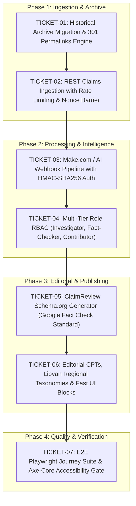

# FALSO 2.0 Delivery Decision Map & Architecture Graph

## Decisions & Boundaries
1. Zero Historical Breakage: Legacy news article URLs from FALSO.LY must map 1:1 via database-level rewrite rules or canonical lookups.
2. Human-in-the-Loop Guarantee: AI scoring outputs (sentiment, hate speech score, entity recognition) are stored strictly as private post meta (`_falso_ai_*`), never as auto-published verdict fields.
3. Google Fact Check Explorer Compliant: Every published investigation automatically embeds a compliant JSON-LD `ClaimReview` graph.
4. Security & Isolation: Public REST API endpoints have rate-limiting barriers. Webhooks from external automation (Make.com) require strict HMAC-SHA256 header validation.
